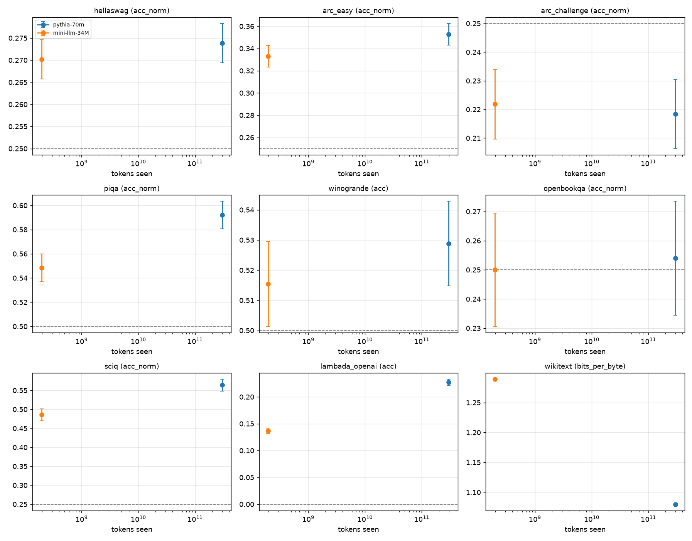
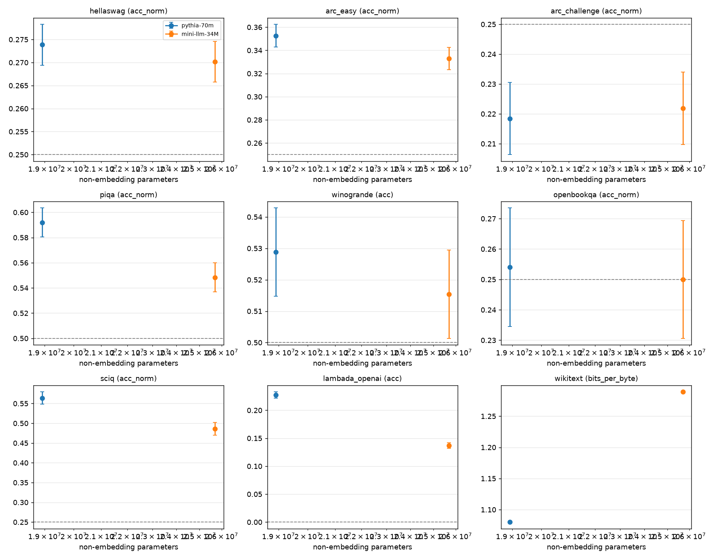

# Results: small_lm

Zero-shot suite chosen to give signal on models under 1B parameters.

Protocol v1, lm-eval 0.4.13, 0-shot. Values are the primary metric of each task with their standard error.

> **Warnings**
>
> - Some runs come from a modified or untracked working tree.

| Model | Non-embedding params | Tokens seen | hellaswag (acc_norm) | arc_easy (acc_norm) | arc_challenge (acc_norm) | piqa (acc_norm) | winogrande (acc) | openbookqa (acc_norm) | sciq (acc_norm) | lambada_openai (acc) | wikitext (bits_per_byte) |
|---|---|---|---|---|---|---|---|---|---|---|---|
| pythia-70m-step143000 | 18.9M | 299.89B | 0.274 ± 0.004 | 0.353 ± 0.010 | 0.218 ± 0.012 | 0.592 ± 0.011 | 0.529 ± 0.014 | 0.254 ± 0.019 | 0.564 ± 0.016 | 0.227 ± 0.006 | 1.080 |
| mini-llm-34M-12000steps | 25.7M | 0.20B | 0.270 ± 0.004 | 0.333 ± 0.010 | 0.222 ± 0.012 | 0.548 ± 0.012 | 0.515 ± 0.014 | 0.250 ± 0.019 | 0.486 ± 0.016 | 0.137 ± 0.005 | 1.289 |
| Random guessing |  |  | 0.250 | 0.250 | 0.250 | 0.500 | 0.500 | 0.250 | 0.250 | 0.000 |  |

## Score against tokens seen

## Score against non-embedding parameters

